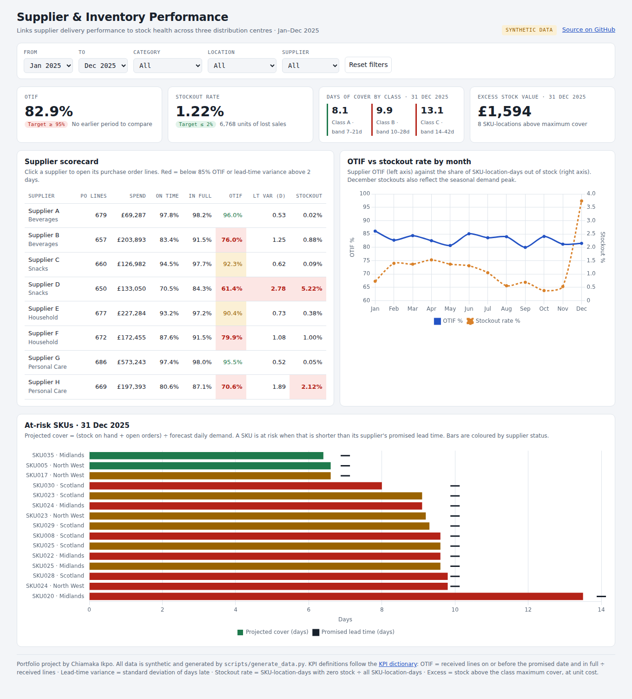
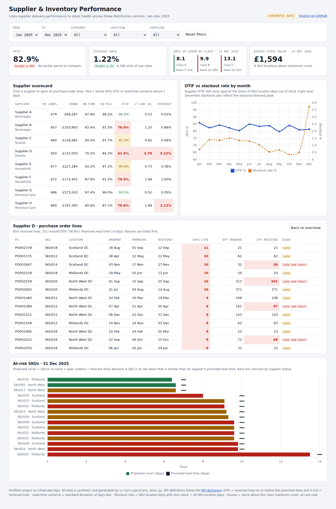

# Supplier & Inventory Performance Dashboard

**Business analysis portfolio project · Chiamaka Ikpo**

A dashboard that links supplier delivery performance to inventory health, so a delivery problem shows up as a stock risk *before* it becomes a stockout.

**[▶ Open the live dashboard](https://chiamakaikpo.github.io/supplier-inventory-dashboard/)** · [Case study write-up](https://chiamakaikpo.github.io/case-dashboard.html)

> **All data is synthetic.** It is generated by `scripts/generate_data.py` for a fictional company with three distribution centres, eight suppliers and 40 SKUs over 2025. No employer data is used.



## The business problem

Buyers look at supplier performance in one place and planners look at stock in another. A supplier that starts delivering late is noticed only when shelves are empty. The goal was **one view connecting supplier performance to inventory health**, built around the questions three stakeholders actually asked.

| Stakeholder | Question |
|---|---|
| Head of Procurement | Which suppliers consistently underperform on timeliness or quantity, and how much spend is exposed? |
| Supply Planner | Which SKUs are at risk of stocking out, and are supplier delays a cause? |
| Finance | How much cash is tied up in excess stock? |

## What I did (BA deliverables)

| Deliverable | File |
|---|---|
| Question log, with decisions each question supports and open questions for stakeholders | [`requirements/question_log.md`](requirements/question_log.md) |
| KPI dictionary: one agreed definition, formula, target and owner per KPI | [`requirements/kpi_dictionary.md`](requirements/kpi_dictionary.md) |
| Star schema data model, grain and volumes | [`requirements/data_model.md`](requirements/data_model.md) |
| Wireframe agreed before building | [`docs/img/wireframe.svg`](docs/img/wireframe.svg) |
| SQL: schema and every KPI query | [`sql/01_schema.sql`](sql/01_schema.sql), [`sql/02_kpis.sql`](sql/02_kpis.sql) |
| Query results | [`sql/results/`](sql/results/) |
| Power BI DAX measures | [`powerbi/measures.dax`](powerbi/measures.dax) |
| Working interactive dashboard | [`docs/index.html`](docs/index.html) ([live](https://chiamakaikpo.github.io/supplier-inventory-dashboard/)) |

## Findings from the data

All figures come from `sql/results/` and can be reproduced with the scripts below.

1. **OTIF is 82.9% against a 95% target.** Only two of eight suppliers (A and G) meet target.
2. **Supplier D is the main cause of stockouts.** It has the lowest OTIF (61.4%) and the least predictable lead time (variance 2.78 days, above the 2-day limit). Its SKUs were out of stock 5.22% of the time and account for **4,307 of 6,768 lost sales units (64%)**.
3. **Reliable suppliers mean almost no stockouts.** SKUs from suppliers A and G were out of stock less than 0.1% of the time.
4. **The largest spend is with a reliable supplier.** Supplier G holds £573k of spend at 95.5% OTIF, so the risk is concentrated in smaller suppliers that are easier to replace or dual-source.
5. **Stock is running below the agreed cover bands.** At 31 December, average cover was 9.9 days for class B (band 10–28) and 13.1 days for class C (band 14–42). The replenishment settings do not deliver the cover policy finance agreed. This is a process gap, not a supplier one.

### Recommendations

- Put suppliers D and H on formal improvement plans; review a second source for D's Snacks range first.
- Plan with each supplier's *actual* lead time plus its variance, not the promised lead time.
- Align replenishment safety stock with the agreed cover bands, or agree new bands with finance.
- Agree the open KPI questions in the question log (early deliveries, partial-delivery tolerance) before go-live.

## Drill-through

Clicking a supplier opens its purchase order lines, with failures listed first.



## How to run it

```bash
pip install pandas numpy
python scripts/generate_data.py        # creates data/*.csv (fixed random seed, so results repeat)
python scripts/build_database.py       # loads SQLite, runs sql/02_kpis.sql, writes sql/results/
python scripts/build_dashboard_data.py # refreshes the data inside docs/index.html
```

Then open `docs/index.html` in a browser.

**Power BI:** import the six CSVs from `data/`, create the relationships in `requirements/data_model.md`, and paste in the measures from `powerbi/measures.dax`.

## Repository structure

```
data/            synthetic star-schema CSVs (4 dimensions, 2 facts)
docs/            live dashboard (GitHub Pages) and images
powerbi/         DAX measures
requirements/    question log, KPI dictionary, data model
scripts/         data generator, SQLite build, dashboard data build
sql/             schema, KPI queries, query results
```

## Tools

Python (pandas, NumPy) · SQL (SQLite) · DAX · HTML/JavaScript (Chart.js) · Power BI
