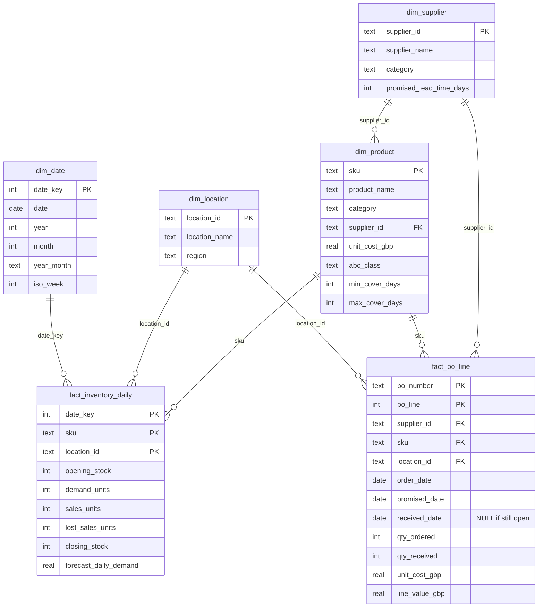

# Data model

Star schema with two fact tables sharing four conformed dimensions. GitHub renders the diagram below.

## Grain and volumes (synthetic year, 2025)

| Table | Grain | Rows |
|---|---|---|
| `fact_po_line` | One purchase order line | 5,413 |
| `fact_inventory_daily` | One SKU, at one location, on one day (closing position) | 43,800 |
| `dim_date` | One calendar day | 365 |
| `dim_product` | One SKU | 40 |
| `dim_supplier` | One supplier | 8 |
| `dim_location` | One distribution centre | 3 |

## Modelling notes

- `fact_po_line` joins to `dim_date` on `promised_date` for OTIF trends (an inactive relationship on `order_date` in Power BI).
- Each SKU has one primary supplier (`dim_product.supplier_id`). This is what lets stockouts in `fact_inventory_daily` be attributed to a supplier.
- In Power BI, filter `dim_supplier` → `dim_product` → `fact_inventory_daily` (single direction) so selecting a supplier filters its SKUs' stock.
